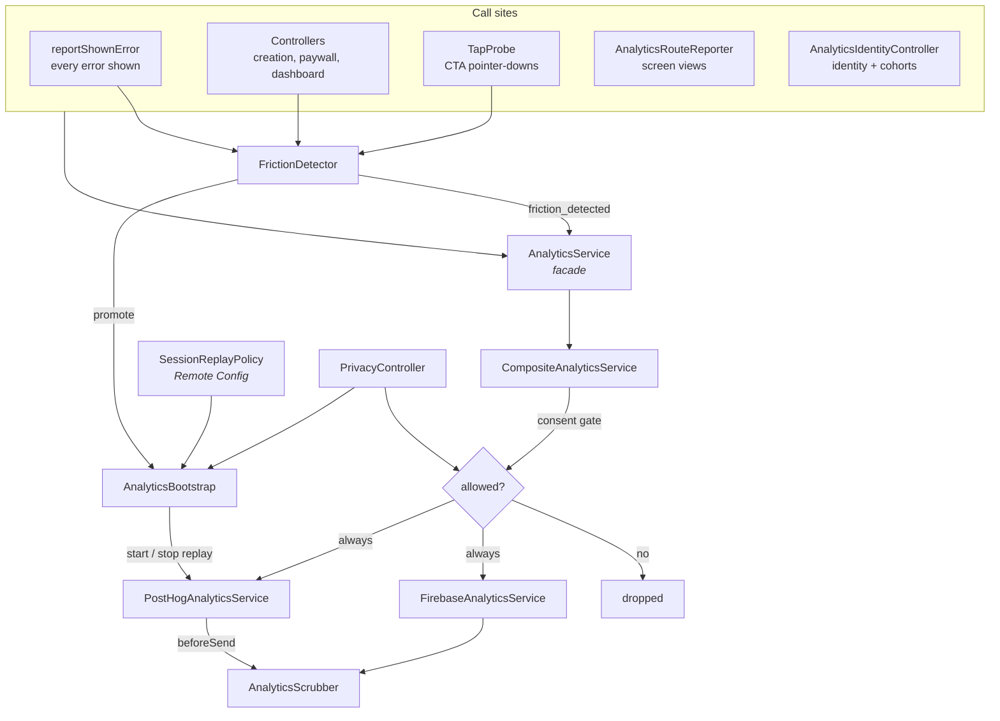

# Analytics

Two destinations behind one interface, answering two questions: **where is the
user's bottleneck**, and **why do people leave**.

| | Firebase Analytics | PostHog (EU Cloud) |
|---|---|---|
| Receives | The whole taxonomy (38) | The whole taxonomy (38), plus session replay |
| Exists for | Day-to-day reading, Play Console, Google Ads, Firebase audiences | Funnels, retention, cohorts, session replay |
| Caveat | A parameter shows in reports only once registered as a custom dimension (50) or metric (50), and registration never backfills — see [Setup](#setup-outside-the-code) | No such caps |

Both get the **Firebase Auth uid** as `distinctId`, so a PostHog funnel and a
Firebase audience describe the same person.

Nothing is filtered by sink: events, screen views, `identify` and user
properties reach both. `isKey` routes nothing — it marks the conversions to
flag as key events in the console.

---

## Flow

---

## Files

### `lib/core/services/domain/`

| File | Role |
|---|---|
| `analytics_service.dart` | The facade every caller depends on. Five methods: `log`, `screen`, `identify`, `setUserProperties`, `reset`. |
| `analytics_event.dart` | The taxonomy — 38 events with their parameters. `isKey` marks a conversion. |
| `friction_kind.dart` | The four shapes of "this person is struggling". |

### `lib/core/services/data/analytics/`

| File | Role |
|---|---|
| `composite_analytics_service.dart` | Fans one call out to both sinks and applies the consent gate. The only place that knows there are two. |
| `firebase_analytics_service.dart` | Firebase sink. Coerces booleans to `1`/`0` and validates property names. |
| `posthog_analytics_service.dart` | PostHog sink, plus SDK setup and the replay start/stop controls. |
| `analytics_scrubber.dart` | Removes personal data from properties on the way out. Pure. |
| `analytics_bootstrap.dart` | Decides per launch whether the session is measured and recorded. |
| `session_replay_policy.dart` | The sampling rule, read from Remote Config. Pure. |
| `friction_detector.dart` | Recognises a struggling user and promotes the session to being recorded. Pure, clock-injected. |
| `analytics_identity_controller.dart` | Keeps identity and cohort attributes in sync. Riverpod, `keepAlive`. |
| `analytics_route_reporter.dart` | One screen view per navigation. Riverpod, `keepAlive`. |

### Elsewhere

| File | Role |
|---|---|
| `core/widgets/tap_probe.dart` | Wraps a CTA; feeds the rage-tap signal. |
| `core/routes/current_screen.dart` | Resolves the current `AppPage` name for event attribution. |
| `core/utils/shown_error_reporter.dart` | Emits `error_shown` — `BaseNotifier` calls it for every controller, and widgets that show an error themselves call it directly. Also reports to Crashlytics; see [crashlytics/README.md](../crashlytics/README.md). |
| `features/settings/domain/models/privacy_settings.dart` | The two consent answers. |
| `features/settings/presenter/controllers/privacy_controller.dart` | Reads and persists them. |
| `core/bootstrap.dart` | Runs `AnalyticsBootstrap` after the Remote Config fetch, and syncs consent changes. |

### Tests

`test/lib/core/services/data/analytics/` covers the scrubber, the composite, the
Firebase sink, the replay policy and the friction detector.
`test/lib/features/settings/.../privacy_controller_test.dart` covers consent.
`test/flows/analytics_flow_test.dart` drives the real app and proves the wiring —
which is the failure mode analytics has, and the one nobody notices until a
funnel has been empty for a month.

---

## Three rules that hold everywhere

**1. Nothing here may break a flow.** Every sink guards its calls, the composite
isolates each sink, and the consent gate fails closed. Provider *construction*
counts: `FirebaseAnalyticsService` takes a factory rather than an instance
because `FirebaseAnalytics.instance` throws without an initialised Firebase app,
and that throw would surface inside whichever controller happened to log first.

**2. No event carries personal data.** Only shape — bucketed counts, ISO codes,
enum names, booleans. Errors are grouped by their **class**, never their
message, which is localized and can quote user input. `AnalyticsScrubber`
enforces this at the edge rather than trusting the taxonomy.

**3. Consent decides, and it fails closed.** Events run on legitimate interest
with an opt-out; session replay is opt-in, asked once at the end of the guided
setup. `PrivacyController` is the source of truth, and a change silences the SDKs
themselves — not just the call sites — so the automatic events stop too. An
answer it cannot read counts as opted out of both, never as the default
"allowed": a storage failure must not undo someone's objection.

---

## Startup sequence

Order matters at three points:

1. **`main.dart`** — `Posthog().setup()` with `optOut: true`. The SDK exists but
   is silent. Starting hot and switching off later would leak a first session
   from someone who had said no.
2. **`bootstrap.dart`** (on the splash, *after* the Remote Config fetch) —
   `applyConsent` then `applySampling`. `enable()` must precede any replay call:
   `startSessionRecording` is inert while the SDK is opted out.
3. **`app.dart`** — the route reporter. It cannot start in the bootstrap: it
   depends on the router, whose notifier awaits the bootstrap, which is a cycle.

The splash is therefore never recorded. That is a feature.

---

## When an event fires

Most events fire where their name says. These do not, and each one changes how
a report must be read:

| Event | Fires | Read it as |
|---|---|---|
| `setup_step_viewed` | On entering each question, the first included, and again on going back to one | Users per `step`, never events |
| `first_service_created` | From the service form **or** the setup, whichever records the account's first service. An account that already had services never sends it | The activation milestone |
| `service_created` | Service form saves only | Plus `setup_completed` with `registered_service = 1` for the services the setup recorded |
| `dashboard_viewed`, `dashboard_empty_state_seen` | Every load of the home: opening it, pull-to-refresh, coming back after a save. Not when switching back to the tab | Users, never events |
| `error_shown` | Every error put in front of the user. `code` is what failed, `<module>/<failure>` (`services/add`); `cause` the platform failure under it (`cloud_firestore/unavailable`) | Group by `code`; versions before the module errors sent the class name (`ExternalError`) |
| `login_failed` | `reason = dismissed` when the provider sheet was closed; otherwise the root cause (`google_sign_in/clientConfigurationError`, `firebase_auth/network-request-failed`) | `dismissed` is a hesitation, anything else a bug |
| `subscription_started`, `subscription_restored` | Only once the store returns premium — a pending purchase or a restore with nothing to restore sends neither | Real conversions |
| `interstitial_load_failed` | Whenever the slot was due and no ad showed, including one still loading | Not necessarily an SDK failure |
| `checklist_step_completed` | Only for steps the app records by hand; steps derived from data (three services, …) never send it | — |

Two parameters share a name with a user property and mean something else:

- **`services_bucket`** on `dashboard_viewed` counts the services in the period
  on screen (`0`, `1-4`, `5-19`, `20-49`, `50+`). The user property counts the
  account's services ever (`0`, `1`, `2-4`, `5-9`, `10-24`, `25-49`, `50-99`,
  `100+`).
- **`tier`** on `paywall_shown` is the tier when the paywall opened; the user
  property is the current one.

User properties are set when the identity is (re)built — sign-in, app start,
and a change of premium, currency, cycle or onboarding segment — not after each
creation. `services_bucket`, `clients_bucket` and `service_types_count` are
therefore as of the last launch.

---

## Adding an event

1. Add a value to `AnalyticsEvent` with its parameters in the doc comment. Set
   `isKey: true` for a conversion. Every event reaches Firebase, so keep
   high-volume, low-meaning ones out of the taxonomy altogether.
2. Register every new parameter in the Firebase console — dimension or metric,
   [below](#custom-dimensions-and-metrics) — **before** the release ships it.
   Firebase keeps the raw value, but reports never show what arrived before
   the registration.
3. Emit it with `unawaited(_analytics.log(...))` from the controller that owns
   the action. Never `await` on a user path.
4. Pass shape, never content. If a parameter could carry an amount or a name,
   the scrubber will redact it — check the denylists before naming a key.
5. If the event is worth asserting, add it to `test/flows/analytics_flow_test.dart`.

---

## Constraints worth knowing before touching this

- **Firebase accepts only `String` and `num` parameter values.** A boolean trips
  an `assert` in debug builds; the Firebase sink coerces them to `1`/`0`.
- **`ref.read` is forbidden inside `ref.onDispose` and `State.dispose`.** The
  form-abandonment report and `paywall_dismissed` capture their dependencies in
  `build`/`initState`.
- **Screen views carry the `AppPage` name as both `screen_name` and
  `screen_class`, and the SDK's automatic screen reporting is off**
  (`google_analytics_automatic_screen_reporting_enabled` in the Android
  manifest, `FirebaseAutomaticScreenReportingEnabled` in `Info.plist`). Flutter
  runs in one activity, so the SDK's own views — and any `logScreenView`
  without a class, which it fills with the host activity — all read
  `MainActivity`. GA's *Pages and screens* report defaults to the *screen class*
  dimension, so that is all it showed.
- **`GoRouter.state`, never `routerDelegate.currentConfiguration`.** The latter
  reports the last declarative match, so every pushed full-screen route would be
  attributed to the tab underneath it. It also throws while the match list is
  empty, which is where the reporter's first call lands.
- **PostHog's rage-click autocapture is iOS/Mac Catalyst only.** Kazi ships on
  Play, which is why `FrictionDetector` and `TapProbe` exist at all.
- **Replay is always screenshot mode on Flutter**, with all text and images
  masked. You see layout, taps, scrolling and where someone stalls — not what is
  written. The events carry the semantics; the replay carries the behaviour.
- **`TapProbe` listens to the pointer, not to `onTap`.** A rage tap is by
  definition a tap the control did not act on.
- **Resolve every dependency before the first `await` when an event is logged
  after one.** A save pops its page and a sign-in redirects away from it, so an
  auto-dispose controller or a widget can be gone when the await returns, and
  `ref` throws from then on. The event is lost without a trace, because the
  sinks never see the call. `first_service_created` and `login_completed` both
  did this.
- **A `reason` is `failureReason(error)`**: the platform failure at the root
  (`cloud_firestore/unavailable`) when there is one, otherwise the error's
  `code` (`auth/deleteData`). Never `runtimeType` — it said `ExternalError` for
  every repository failure, and turns into `a3` under `--obfuscate`.

---

## Setup outside the code

Until these are done the funnels stay empty:

- `POSTHOG_API_KEY` and `POSTHOG_HOST` in the three gitignored `.env.*` files.
  Use **two separate PostHog projects**, staging and production — test data in a
  production project contaminates funnels, retention and the replay quota
  irreversibly.
- The five Remote Config keys: `replay_enabled`, `replay_sample_new_users`,
  `replay_sample_returning`, `replay_on_friction`, `replay_new_user_days`.

  There is deliberately no remote switch for events themselves: the two halves
  that can cost money or privacy carry their own, and the rest stops at the
  user's opt-out.
- Mark `login_completed`, `setup_completed`, `first_service_created` and
  `subscription_started` as key events (Admin → Key events → New key event; the
  name can be entered before the event has ever arrived). Of the other `isKey`
  events, `currency_migration_confirmed` fires inside every setup, and
  `paywall_shown` and `subscribe_tapped` count people who merely saw or tapped,
  so they build audiences but would inflate a conversion.
- Register the parameters below. Until then they reach Firebase but show in no
  report, and registration does not backfill.
- Enable **Record user sessions** in the PostHog project settings. Without it
  every replay API in this folder is inert.

### Custom dimensions and metrics

In **Admin → Custom definitions**. Booleans arrive as `1`/`0` on events and as
`true`/`false` on user properties.

**Event-scoped** — the parameter name is the dimension name:

| Register as | Parameters |
|---|---|
| Dimension (31 of 50) | `backfilled_bucket`, `cause`, `code`, `commission_configured`, `context`, `entity`, `flow`, `form`, `from`, `had_validation_error`, `has_client`, `has_data`, `has_schedule`, `hint`, `is_new_user`, `is_trial`, `is_trial_eligible`, `kind`, `last_field`, `limit_type`, `origin`, `profession`, `provider`, `reason`, `registered_service`, `screen`, `services_bucket`, `source`, `step`, `tier`, `to` |
| Metric (7 of 50), unit *Standard* | `count`, `filled_fields`, `quantity`, `seconds`, `seconds_to_create`, `seeded_types`, `unconverted_count` |

**User-scoped** (10 of 25) — set by `AnalyticsIdentityController`. A dimension
name must be unique across both scopes, so the two that collide with an event
parameter get a suffix:

| Dimension name | User property |
|---|---|
| `tier (user)` | `tier` |
| `services_bucket (user)` | `services_bucket` |
| *same as the property* | `is_premium`, `default_currency`, `billing_cycle`, `payments_enabled`, `flavor`, `onboarding_segment`, `clients_bucket`, `service_types_count` |

Two properties are sent but not worth a slot: `app_version` duplicates GA's
built-in *App version*, and `account_age_days` has a value per day — use a
cohort on `first_open` instead.

`flavor` is what separates `prod_test` — which shares the production Firebase
project — from real users: filter `flavor ≠ prod_test` in every exploration.

User properties (set by `AnalyticsIdentityController`) are registered separately,
with scope **User**. Where a name is also an event parameter, give the dimension a
`user_` prefix, since dimension names must be unique:

| Register as | Parameters |
|---|---|
| User dimension (9 of 25) | `flavor`, `tier` (as `user_tier`), `onboarding_segment`, `default_currency`, `billing_cycle`, `payments_enabled`, `services_bucket` (as `user_services_bucket`), `clients_bucket`, `account_age_days` |

`flavor` is the one to register first: `prod_test` shares the prod Firebase
project, so filtering `flavor = prod` is what keeps test devices out of the
numbers. `is_premium` repeats `tier`, `app_version` is the built-in **App
version**, and `service_types_count` is a count better read from
`setup_completed`, so the three stay unregistered.

`currency` is not registered: GA4 reserves it and already shows it as the
built-in **Currency** dimension, so the console refuses a custom one.

Some names are shared on purpose — `kind`, `source`, `from`/`to`, `reason` — so
one dimension serves several events, and the event name says which meaning
applies. Reuse an existing name before spending a new slot.
